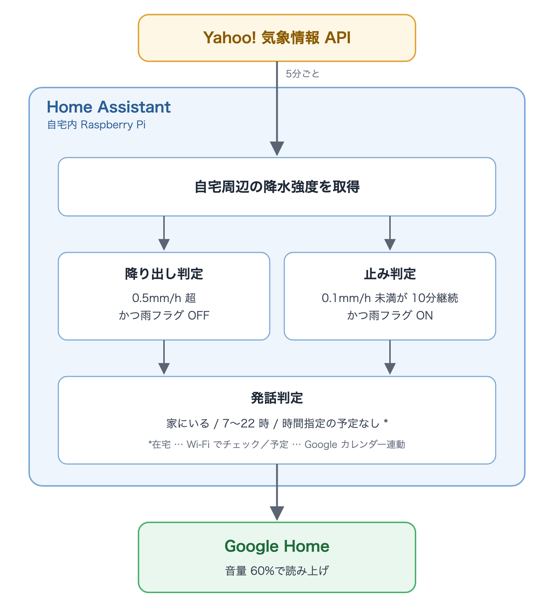

# ha-rain-announce

[日本語](#日本語) | [English](#english)



## 日本語

雨が降り出したとき・やんだときに、Home Assistant からスマートスピーカー（Google Home など）に発話させる設定です。

### 動き

| 判定 | 条件 | 雨フラグ |
|---|---|---|
| 降り出し | 降水強度が 0.5 mm/h を超えた、かつ雨フラグが OFF | ON にする |
| 止み | 0.1 mm/h 未満が 10 分続いた、かつ雨フラグが ON | OFF にする |

- 雨フラグは発話しないときも更新します。ずっと晴れている日に「やみました」と言わないためです
- 発話するのは、在宅・指定の時間帯（初期値 7〜22 時）・カレンダーに時間指定の予定が無い、をすべて満たすときだけです
- 読み上げ中だけ音量を上げ、数秒後に元の音量へ戻します
- 数値と文言は Blueprint の入力で変えられます

### 必要なもの

- Home Assistant（2024.10 以降）
- Yahoo! JAPAN の**アプリケーション ID**
- TTS エンジン（下の例は Google 翻訳 TTS）
- HA から再生できるスピーカー
- 在宅判定に使う `person`、予定を見る `calendar`（どちらも任意）

Yahoo! 気象情報 API は日本国内の座標だけに対応しています。

### 設定

#### 1. アプリケーション ID を取得する

[Yahoo!デベロッパーネットワーク](https://developer.yahoo.co.jp/) でアプリケーションを登録し、Client ID（アプリケーション ID）を控えます。

`secrets.yaml` に追記します。

```yaml
yolp_appid: <取得したアプリケーション ID>
```

#### 2. 降水強度センサーと雨フラグを追加する

[`configuration.yaml.example`](configuration.yaml.example) の中身を `configuration.yaml` に追記し、HA を再起動します。

- 座標は HA の「ホーム」ゾーンから読むので、書き換えは不要です
- 再起動後、`sensor.yolp_rain_intensity` に mm/h の値が入り、`input_boolean.was_raining` ができていることを確認します

この 2 つは Blueprint に含められないため、手で追記します。

#### 3. Blueprint を取り込む

[](https://my.home-assistant.io/redirect/blueprint_import/?blueprint_url=https%3A%2F%2Fgithub.com%2Funicco%2Fha-rain-announce%2Fblob%2Fmain%2Fblueprints%2Fautomation%2Frain_announce.yaml)

ボタンが使えない場合は、「設定 → オートメーションとシーン → ブループリント → ブループリントをインポート」に次の URL を貼ります。

```
https://github.com/unicco/ha-rain-announce/blob/main/blueprints/automation/rain_announce.yaml
```

#### 4. オートメーションを作る

取り込んだ Blueprint から作成し、次を選びます。

| 入力 | 選ぶもの |
|---|---|
| 降水強度センサー | `sensor.yolp_rain_intensity` |
| 雨フラグ | `input_boolean.was_raining` |
| スピーカー | 読み上げさせる `media_player` |
| TTS エンジン | 例: `tts.google_translate_en_com`（言語は `ja` のままで日本語を読みます） |
| 在宅を判定する人・予定を見るカレンダー | 任意 |

### 注意

- **アプリケーション ID は人と共有しないでください。** 公開するリポジトリや記事に書かず、`secrets.yaml` に置きます
- Yahoo! の Web API は、原則として**利用者自身の便宜のための非商用目的**で使えます（[WebAPI の商用利用](https://support.yahoo-net.jp/PccDeveloper/s/article/H000011080)）。利用上限は 1 アプリケーションにつき 24 時間で 5 万リクエストで、5 分ごとの取得なら 1 日 288 回です
- Yahoo! 気象情報 API・Google 翻訳 TTS とも、提供の継続は保証されていません。Google 翻訳 TTS は非公式の読み上げ機能を使う統合なので、使えなくなったら Google Cloud TTS や Piper など別の TTS エンジンに差し替えてください
- カレンダーの「終日の予定」は無視します。終日予定を入れると、ずっと発話しなくなるためです

## English

Home Assistant configuration that makes a smart speaker (such as Google Home) announce when rain starts and when it stops.

> **Japan only.** The rain data comes from the Yahoo! JAPAN Weather API (YOLP), which only covers locations in Japan.

### How it works

| Check | Condition | Rain flag |
|---|---|---|
| Rain starts | Rainfall rises above 0.5 mm/h and the rain flag is OFF | Turn ON |
| Rain stops | Rainfall stays below 0.1 mm/h for 10 minutes and the rain flag is ON | Turn OFF |

- The rain flag is updated even when nothing is announced, so the speaker never says "it stopped raining" on a dry day
- It speaks only when all of these are true: someone is home, it is within the set hours (default 7:00–22:00), and no timed calendar event is in progress
- The volume is raised only while speaking and restored a few seconds later
- Thresholds, hours and messages can be changed in the Blueprint inputs

### Requirements

- Home Assistant 2024.10 or later
- A Yahoo! JAPAN **application ID**
- A TTS engine (the example below uses Google Translate TTS)
- A speaker that Home Assistant can play to
- Optional: `person` entities for presence, `calendar` entities for events

### Setup

#### 1. Get an application ID

Register an application at the [Yahoo! JAPAN Developer Network](https://developer.yahoo.co.jp/) and note its Client ID (application ID).

Add it to `secrets.yaml`:

```yaml
yolp_appid: <your application ID>
```

#### 2. Add the rainfall sensor and the rain flag

Append the contents of [`configuration.yaml.example`](configuration.yaml.example) to `configuration.yaml` and restart Home Assistant.

- The coordinates are read from your Home zone, so you do not need to edit them
- After restarting, check that `sensor.yolp_rain_intensity` shows a value in mm/h and that `input_boolean.was_raining` exists

These two cannot be included in a Blueprint, so they are added by hand.

#### 3. Import the Blueprint

[](https://my.home-assistant.io/redirect/blueprint_import/?blueprint_url=https%3A%2F%2Fgithub.com%2Funicco%2Fha-rain-announce%2Fblob%2Fmain%2Fblueprints%2Fautomation%2Frain_announce.yaml)

If the button does not work, go to Settings → Automations & Scenes → Blueprints → Import Blueprint and paste this URL:

```
https://github.com/unicco/ha-rain-announce/blob/main/blueprints/automation/rain_announce.yaml
```

#### 4. Create the automation

Create an automation from the imported Blueprint and select:

| Input | Select |
|---|---|
| Rainfall sensor | `sensor.yolp_rain_intensity` |
| Rain flag | `input_boolean.was_raining` |
| Speaker | The `media_player` to speak on |
| TTS engine | e.g. `tts.google_translate_en_com` (set the language to `en` for English messages) |
| People / calendars | Optional |

The default messages are in Japanese. Change the language and both messages in the Blueprint inputs to use another language.

### Notes

- **Do not share your application ID.** Keep it in `secrets.yaml`, not in public repositories or articles
- Yahoo! JAPAN Web APIs are, in principle, for **non-commercial use for the user's own convenience** ([commercial use, in Japanese](https://support.yahoo-net.jp/PccDeveloper/s/article/H000011080)). The limit is 50,000 requests per application per 24 hours; polling every 5 minutes uses 288 a day
- Neither the Yahoo! JAPAN Weather API nor Google Translate TTS is guaranteed to stay available. Google Translate TTS relies on an unofficial speech feature, so switch to another TTS engine such as Google Cloud TTS or Piper if it stops working
- All-day calendar events are ignored, because a long all-day event would otherwise keep the speaker silent

## ライセンス / License

[MIT](LICENSE)

---

[Webサービス by Yahoo! JAPAN](https://developer.yahoo.co.jp/sitemap/)

[Web Services by Yahoo! JAPAN](https://developer.yahoo.co.jp/sitemap/)
